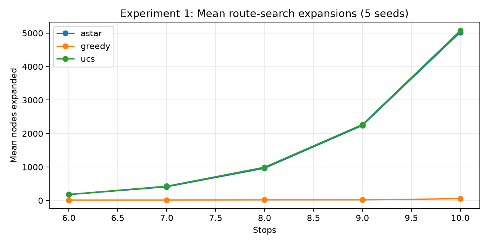
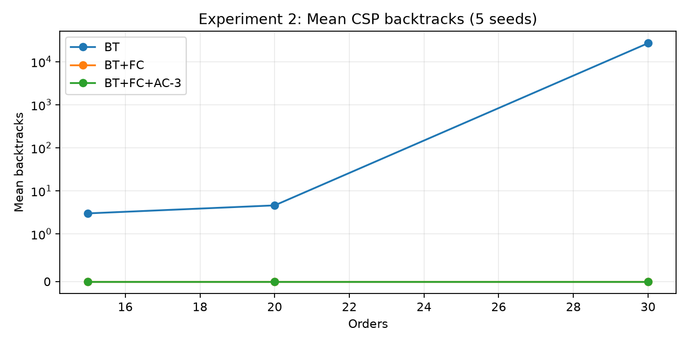
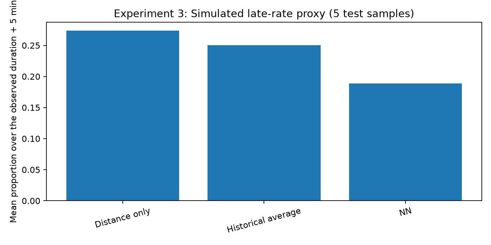

# Delivery routing with learned travel times

## Abstract

This project trains a small neural network to estimate taxi trip duration from
real New York City Taxi and Limousine Commission (TLC) records, then uses those
estimates in a demonstration dispatcher. A constraint-satisfaction problem
(CSP) assigns orders to three vans, and A* orders stops for each van. The
September 2026 TLC records support a real trip-time prediction experiment, but
they do not include courier orders, delivery windows, van capacities, or depot
assignments. Accordingly, the dispatcher inputs and its late-budget allowance
are explicitly generated scenarios; the project does not claim measured
courier performance.

## 1. Problem and data

The original routing problem needs trip-time estimates, vehicle assignment,
and stop sequencing. The provided workspace contained September 2026 FHVHV
trips and a taxi-zone lookup. To match the README's Yellow/Green data
description, the September Yellow and Green trip files were also downloaded
from the official TLC public storage referenced by the
[TLC trip-data catalog](https://www.nyc.gov/site/tlc/about/tlc-trip-record-data.page).

| Real source | September 2026 rows |
|---|---:|
| FHVHV | 20,987,681 |
| Yellow Taxi | 3,876,044 |
| Green Taxi | 46,676 |

The data script streams the required columns in batches and retains weekdays
with known TLC zone IDs, positive distance, and duration between 1 and 120
minutes. FHVHV duration uses its `trip_time` seconds field; Yellow and Green
duration is drop-off time minus pickup time. The final reproducible sample has
240,000 training records and 60,000 test records. Training pickups are from
September 1–23; testing pickups are from September 24–30. The top 20 pickup
zones and pair-mean distances are computed from training records only.

## 2. Design

### Duration model

The neural network is an `MLPRegressor` with 32- and 16-unit hidden layers.
Inputs are pickup zone, drop-off zone, hour, weekday, and training-only mean
pair distance; the target is duration in minutes. Categorical inputs are
one-hot encoded and the distance feature is standardized. Early stopping is
enabled. The fixed-seed run stopped at 25 iterations.

Two training-only baselines are used: mean duration by zone pair and a
distance-only estimate based on median training minutes per mile. All metrics
are computed on the held-out days.

### CSP and route search

Each generated order is a CSP variable with the three vans as possible
values. Unary checks enforce single-order depot reachability and vehicle
capacity. A pair receives a different-van constraint if neither service order
can meet both time windows under the learned travel estimates. The solver
implements backtracking, forward checking, and AC-3. It records assignments,
backtracks, nodes, and domain values pruned; a node limit is reported as
inconclusive rather than as proof of infeasibility.

For each van, route search state is the current zone, completed-order bitmask,
and clock. The route objective adds predicted travel, waiting, and generated
service time. A* uses a lower bound equal to the sum of each unvisited stop's
cheapest possible incoming travel time. UCS and Greedy are implemented as
comparators. An exact six-stop permutation checker validates A* on a small
known instance.

The integrated flow is learned travel-time matrix → CSP assignment → A* route.
If A* reports a late order pair, the integration adds a different-van rule and
retries assignment up to five times. A failed plan reports a reason and
15-minute window-widening suggestions where time windows are implicated.

## 3. Results

### Neural network on held-out real trips

| Method | MAE (minutes) | RMSE (minutes) |
|---|---:|---:|
| Neural network | 5.094 | 7.434 |
| Historical zone-pair mean | 6.546 | 9.450 |
| Distance only | 14.464 | 25.965 |

The NN's MAE is about 22% lower than the historical pair average and 65%
lower than the distance-only baseline on this sample. This is a one-month,
one-city experiment; it does not establish that the estimates generalize to
other months, unusual conditions, or delivery vans.

### Experiment 1: route search

Across five fixed seeds for each stop count, A* and UCS returned the same mean
cost for the tested instances, while Greedy used fewer expansions but returned
more expensive routes. For 10 stops:

| Method | Expanded states (mean ± SD) | Cost, minutes (mean ± SD) |
|---|---:|---:|
| A* | 5,026 ± 25 | 298.71 ± 16.87 |
| UCS | 5,074 ± 25 | 298.71 ± 16.87 |
| Greedy | 53 ± 78 | 382.35 ± 16.49 |

The six-stop trace also matched the brute-force optimum: both costs were
134.351 minutes (floating-point difference below 1e-12).

### Experiment 2: CSP propagation

The following are five-seed means; CSV summaries also include sample standard
deviations. BT's first-order search can take substantially more work on the
30-order cases. One 30-order BT run reached its 100,000-node limit and is
marked incomplete in the raw results; it is not treated as a proven
no-solution case.

| Orders | Configuration | Backtracks (mean ± SD) | Values pruned (mean ± SD) |
|---:|---|---:|---:|
| 15 | BT | 3.0 ± 4.12 | 0.0 ± 0.0 |
| 15 | BT+FC | 0.0 ± 0.0 | 19.6 ± 1.82 |
| 15 | BT+FC+AC-3 | 0.0 ± 0.0 | 19.6 ± 1.82 |
| 20 | BT | 4.6 ± 10.29 | 0.0 ± 0.0 |
| 20 | BT+FC | 0.0 ± 0.0 | 25.6 ± 1.67 |
| 20 | BT+FC+AC-3 | 0.0 ± 0.0 | 25.6 ± 1.67 |
| 30 | BT | 26,923 ± 59,909 | 0.0 ± 0.0 |
| 30 | BT+FC | 0.0 ± 0.0 | 41.8 ± 3.11 |
| 30 | BT+FC+AC-3 | 0.0 ± 0.0 | 41.8 ± 3.11 |

On these generated instances, forward checking did most of the measured
pruning. AC-3 had no additional mean pruning beyond FC in this experiment,
though the separate trace includes an inconsistent-domain example where AC-3
detects failure before search assignments. AC-3 adds runtime, so the results
do not justify claiming it is always faster.

### Experiment 3: held-out-trip replay proxy

Five seeded samples of 10,000 held-out real trips compare duration predictions.
The synthetic budget is observed trip duration plus five minutes. It is not a
real delivery deadline, and the numbers below are **simulated-late proxies**,
not observed late deliveries.

| Method | Proxy late rate (mean ± SD) | MAE minutes (mean ± SD) |
|---|---:|---:|
| Neural network | 18.85% ± 0.28% | 5.067 ± 0.039 |
| Historical zone-pair mean | 25.02% ± 0.27% | 6.491 ± 0.059 |
| Distance only | 27.36% ± 0.35% | 14.354 ± 0.108 |

## 4. Validation and reproducibility

Twenty-one tests cover ordinary cases, edge cases, impossible cases with clear
messages, the deterministic generator, window-widening suggestions, search
limits, and the six-stop A* vs brute-force check. The data sample and generated
orders use fixed seeds. Run `python -m eval.experiments` to recreate the
per-seed tables, mean/std CSVs, and three plots under `outputs\experiments\`.

The tested model metrics are saved in `artifacts\model_metrics.json`. The
seeded demo-order CSV, assigned-plan JSON, hourly zone-pair predictions, and
integrated route plots are saved under `outputs\`, with separate
route/matrix/plan filenames for NN, historical, and distance travel-time
choices.

## 5. Limitations and conclusion

The learned target is taxi trip duration, not courier time. TLC rides do not
identify delivery workloads, business service times, depot location, fleet
capacity, or actual delivery deadlines. The generated order scenarios prove
that the algorithms can cooperate; they do not prove that the assumed
dispatcher problem matches a real company. The five-minute replay allowance
is also synthetic. TLC cautions that the trip data may be inaccurate.

Within those limits, the NN outperformed both tested time baselines on the
held-out September records, A* matched the exact small-instance solution, and
forward checking substantially reduced CSP backtracking in the larger
generated cases. Real courier operations data would be necessary to validate
delivery feasibility and actual lateness.
